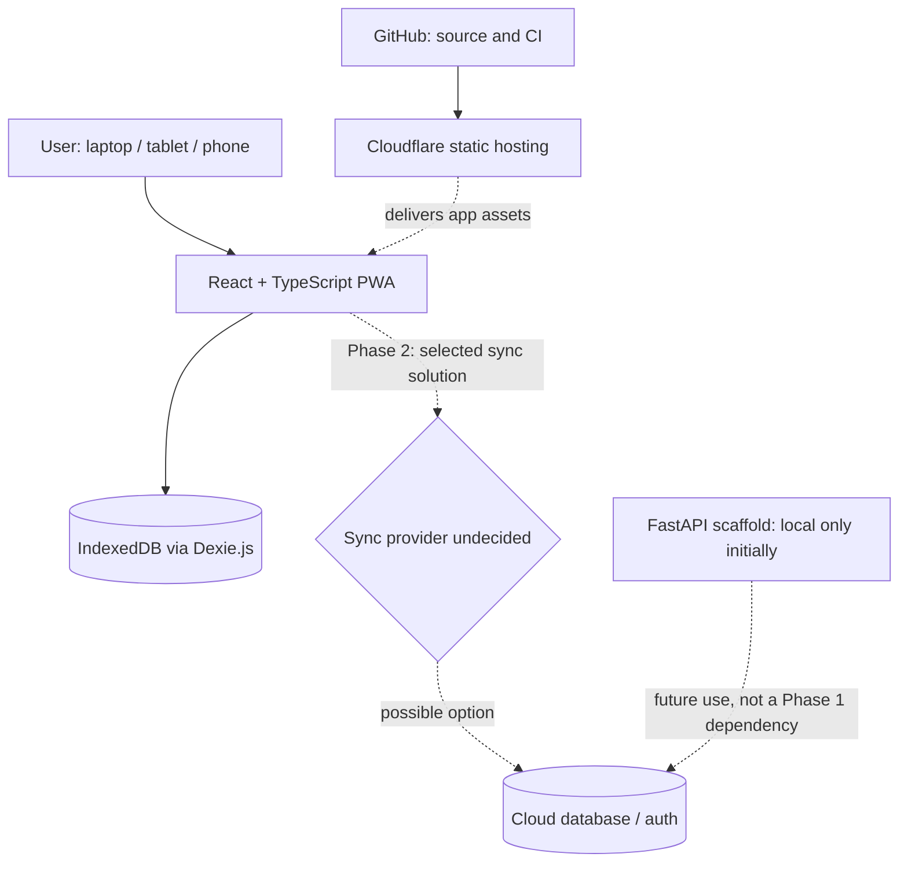
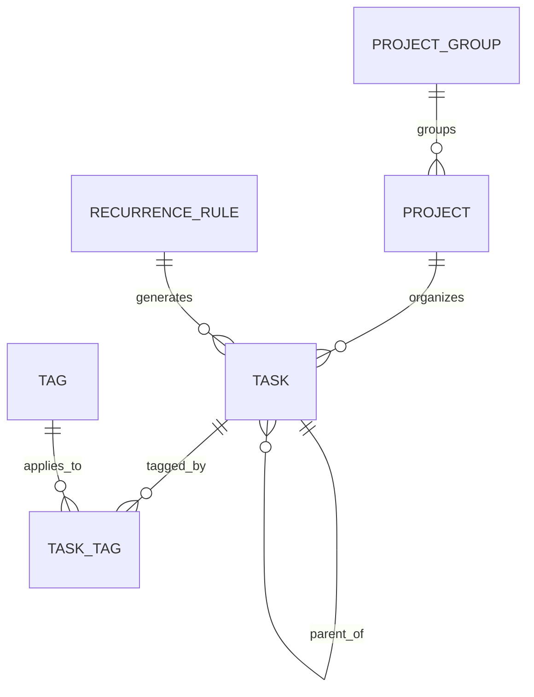

# Planner

> **Status:** Planning complete for the first development milestone; implementation not started.

## Why this project exists

Productivity tools often split TODO lists, daily planning, focus sessions, and calendars across separate apps. Rigid time blocking can make starting work feel overwhelming. This project is an attempt to create a **low-friction, customizable planner**: capture a task quickly, choose a day (not a time), and let unfinished work gently roll into today. It begins as a personal tool but is architected for potential use by others in the future. 

## Product vision

A responsive, installable planner for laptop, tablet, and phone; offline-first in its core experience, with cross-device synchronization a **required later milestone**. Users can choose color themes, curated aesthetic presets and fonts (with custom themes as a product goal), organize courses and other projects, see deadlines, focus using Pomodoro sessions, and eventually use rewards and unified calendars.

## Current project state

- **Agreed:** personal-first, product-ready; 7-day rolling Kanban; optional deadlines; projects/groups; global tags; optional subtasks; basic recurring tasks; important flag; compact Upcoming/sidebar.
- **Planned, not built:** all application features below. No claim of functioning synchronization, hosting, or implementation.
- **Deferred decisions:** cloud sync/database provider, auth provider, conflict resolution, operational backup plan. See [Decisions](docs/DECISIONS.md).

## Feature map and scope

| Stage | Scope |
|---|---|
| Phase 0 | Docs, implementation boundaries, repo setup, test/lint conventions |
| Phase 1 | Local-first tasks, projects/groups, tags, 7-day rolling Kanban, Upcoming, Later, recurrence, retention, theme foundations and basic theme/font selection |
| Phase 2 | Accounts, cloud synchronization, cross-device offline reconciliation |
| Phase 3 | Pomodoro, linked task lists, time and completion statistics, project charts |
| Phase 4 | Rewards/gamification, Google Calendar aggregation, free/busy sharing |
| Ideas | Advanced recurrence, priority-display modes, garden/collectibles, enhancements without commitment |

**First implementable milestone:** quick-add a task, persist it locally, schedule it into the 7-day board, refresh, and find it unchanged. See [Milestone 1 spec](specs/001-local-task-slice/spec.md).

## Technology stack — proposed starting architecture

| Layer | Choice | Reason / status |
|---|---|---|
| UI | React + TypeScript + Vite | Flexible, testable web application |
| Styling | Tailwind CSS | Responsive UI and theme tokens |
| Local data | IndexedDB via Dexie.js | Local-first browser persistence |
| Frontend hosting | Cloudflare (Pages/Workers deployment target TBD) | Free-tier-oriented, GitHub deployment; not yet provisioned |
| Backend scaffold | Python 3.11+ / FastAPI / uv / pytest / ruff | Reserved for future server-side needs; **not deployed** in Phase 1 |
| UI test/lint | Vitest, React Testing Library, ESLint / TypeScript | Proposed implementation defaults, to validate during setup |
| Cloud data/auth/sync | **Undecided** (Supabase/PostgreSQL vs Dexie Cloud and alternatives) | Phase 2 evaluation required; do not implement custom sync prematurely |
| Orchestration | Spec Kit + Codex CLI in VS Code | Human-reviewed, small implementation steps |

## System architecture

**Data ownership:** the local browser holds usable task records; future cloud copies must be private per user, portable/exportable, and recoverable. Hosting the frontend is **not** the same as hosting a database. Browser data alone does **not** sync between devices. Details: [Architecture](docs/ARCHITECTURE.md), [Data model](docs/DATA_MODEL.md).

## Core user experience

- **Upcoming (top):** deadline-driven; seven-day lookahead, with unscheduled actionable cards and scheduled items as a compact list. Unscheduled overdue tasks remain visible.
- **Board:** seven columns for today through today + 6, manual drag order, optional due-date/project sort. Day assignment is not a time block.
- **Side drawer:** five relevant unscheduled tasks by default with View all; **Later** contains tasks planned after the seven-day window, sorted by planned date. On mobile use a drawer.
- **Quick add:** title + Save / More options; Enter saves. Inbox/project list retains focus for rapid entry; Kanban/day and detail editor close after save. Creation context sets project/date when relevant.
- **Rollover:** unfinished ordinary tasks scheduled before today render in today's column without changing the stored planned date. Explicit move/date edit changes stored date.
- **Appearance:** theme choices include light/dark, pastel and rainbow color palettes; aesthetic presets (e.g., Green Botanist, Light/Dark Academia, Starry Night) and custom palette/preset editing are planned in stages. Initial font choices: DM Sans, Cormorant Garamond, Courier Prime, JetBrains Mono and Space Grotesk. See [Appearance specification](specs/005-appearance-offline-deploy/spec.md). Task cards follow theme; only small flags/badges signal **Due today** (amber), **Overdue** (red), **Completed** (green), or important priority. Ordinary incomplete tasks have no status badge.

## Data model summary

All associations shown are conceptual; group/project/parent/tag/recurrence assignment is optional where applicable. A task has distinct optional `due_date` and `planned_date`. Project progress counts **top-level** tasks only; parents are manually completed. See [Data model](docs/DATA_MODEL.md) for fields, invariants, and unresolved schema details.

## Appearance and customization

Treat **color palette**, **curated theme preset** (palette + typography), and **font choice** as separate user preferences. Theme tokens style surfaces, text, borders and accents consistently; only small status badges/flags use semantic status colors. Phase 1 introduces the token system and a limited functional selection, then expands through later approved increments; the full desired theme catalog and custom editors are product requirements, **not claims of completed UI**. See [appearance spec](specs/005-appearance-offline-deploy/spec.md), [decisions](docs/DECISIONS.md) and [ideas](docs/IDEAS.md).

## Engineering approach

Develop in small, testable vertical slices: **propose → human validation → prune obsolete code**. Prefer surgical edits to existing code; use readable names, Google-style docstrings, type hints, appropriate unit tests, and no orphaned files. Git branches are short/lowercase and commits use one-line Conventional Commits. [Agent rules](AGENTS.md) codify the constraints; [feature specs](specs/) define exact behavior.

## Documentation index

- [Architecture and deployment](docs/ARCHITECTURE.md) — runtime boundaries, ownership, hosting, future synchronization choices
- [Customization vision](docs/CUSTOMIZATION.md) — color families, curated presets, fonts, and rollout
- [Data model](docs/DATA_MODEL.md) — entities, recurrence, status derivation, rollover and deletion
- [Decision log](docs/DECISIONS.md) — terse agreed choices and deferred decisions
- [Roadmap](docs/ROADMAP.md) — phases, milestones, exit checks
- [Progress log](docs/PROGRESS.md) — verified work only; not aspirational checkboxes
- [Ideas / nice-to-haves](docs/IDEAS.md) — explicitly uncommitted enhancements
- [Feature specs](specs/) — [M0 foundation](specs/000-foundation/spec.md), [M1 local tasks](specs/001-local-task-slice/spec.md), [M2 board/inbox](specs/002-planner-board/spec.md), [M3 organization](specs/003-organization/spec.md), [M4 lifecycle](specs/004-task-lifecycle/spec.md), [M5 appearance/offline/deployment](specs/005-appearance-offline-deploy/spec.md)
- [Codex instructions](AGENTS.md) — engineering standards and hygiene

## Running locally / deployment

No app has been scaffolded yet, so install/test/deploy commands are **TBD and must be filled in only after validated setup**. Planned flow: VS Code + Spec Kit + Codex → tests and review → GitHub → Cloudflare deployment. Cloudflare deployment does not imply a running Python server or a synchronized database.

## Design rationale, tradeoffs, and learning log

The major tradeoff is **immediate simplicity vs. eventual synchronization**: Phase 1 uses local storage while keeping IDs, ownership, and data boundaries ready for Phase 2. Rollover is a view calculation rather than a midnight database mutation. Deadline status is computed instead of stored. The README summarizes *why*; [Decisions](docs/DECISIONS.md) records the choices and alternatives, and [Progress](docs/PROGRESS.md) will document tested outcomes, lessons, blockers, and changes as development actually occurs. No retrospective lessons or performance results are claimed yet.

**Source context:** initial ideas in `Planners.pdf`; engineering guardrails in `chatgpt-workflow-context.md`; subsequent design decisions from planning conversations. Keep those originals as references outside the implementation tree or link to their maintained copies if added later.
