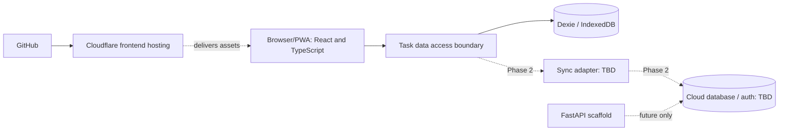

# Architecture and deployment

## Goals / constraints

- Zero recurring infrastructure cost in Phase 1, subject to current free-tier limits; no paid domain required.
- Offline local task use; sync across devices is explicitly required in Phase 2, **not delivered by Phase 1**.
- Personal-first, product-ready; separate UI/domain behavior from concrete persistence or cloud choices.
- Keep Python backend minimal and local-only until it performs a justified function.

## Context diagram

## Responsibilities

| Part | Owns | Does NOT own in Phase 1 |
|---|---|---|
| React UI | interaction, render, keyboard focus, derived badges and current-day views | remote synchronization |
| Domain selectors/services | rollover, Upcoming grouping, recurrence projection, progress, filtering | hosting-specific logic |
| Storage boundary | typed task/project/tag CRUD, stable local IDs, soft deletion | fixed vendor-specific cloud API |
| Dexie/IndexedDB | local records, schema migrations | multi-device sharing |
| Cloudflare | served static build and deployment | PostgreSQL / Python runtime by itself |
| FastAPI skeleton | future server boundary + basic health check | duplicate task CRUD or fabricated endpoints |

## Important boundaries and failure modes

1. **Offline:** IndexedDB data can work offline, but making the *app shell* load offline requires an explicit service-worker/cache milestone. Browser data can be evicted; implement export/backup and test persistence assumptions.
2. **Sync:** Dexie local records do not automatically sync to Supabase. Phase 2 must choose a mechanism, test concurrent edits, deletion tombstones, offline queue, migration, and account ownership. Avoid bespoke sync prematurely.
3. **Accounts:** `owner_id` is conceptual in local-only mode and must not be treated as authorization. Phase 2 needs authenticated per-user enforcement on the server.
4. **Dates:** date-only fields are local calendar dates (`YYYY-MM-DD`), not midnight UTC timestamps. Timezone and rollover are evaluated consistently using the user's selected/local timezone.
5. **Deletion:** recoverable locally for 14 days; Phase 2 needs a separate propagation/tombstone policy so old devices cannot resurrect deleted tasks.
6. **Security:** no secrets in browser code; only public client configuration is bundled; access-control/backup review before external users.

## Hosting / deployment decision

Cloudflare is the **preferred** managed frontend host, connected to GitHub once configured. It provides an address for the compiled React app, not persistent task sync. Frontend deployment target (Pages vs Workers) is a setup decision, not evidence it is deployed. Python may remain unhosted until there's a genuine server requirement.

## Phase 2 selection rubric (unresolved)

Compare cloud + sync combinations against: ongoing **$0 cost** under realistic use, user-seat ceilings, inactive-project pausing, portability/export, managed offline sync, concurrency/conflict behavior, deletion propagation, auth/privacy, and provider exit path. Supabase/PostgreSQL and Dexie Cloud are candidates, not commitments. Don't make migrations or credentials dependent on an undecided vendor.

## Future extension points

- Pomodoro focus sessions linked to tasks/tags; metrics calculated from real sessions.
- Google Calendar via authenticated integration; external calendar events retain external-source ownership.
- Multi-user isolation and opt-in free/busy sharing, not public tasks by default.

## Appearance boundary (Phase 1 foundation)

- Use semantic design tokens (`surface`, `text`, `border`, `accent`, `status-*`) instead of hard-coded card colors. Theme definitions and font choices are configuration, not per-component styling.
- Store `palette_id`, `font_id`, and optional `preset_id` as local preferences; customizable user-defined palettes and composite presets are a subsequent milestone, with a portable representation planned before implementing the editor.
- Light/dark variants and color palettes must maintain readable contrast; status flags carry semantic colors while the whole card follows its theme.
- Consider font asset licensing and offline availability; never rely exclusively on runtime third-party font downloads for offline use.
- Do not introduce a backend for themes.
