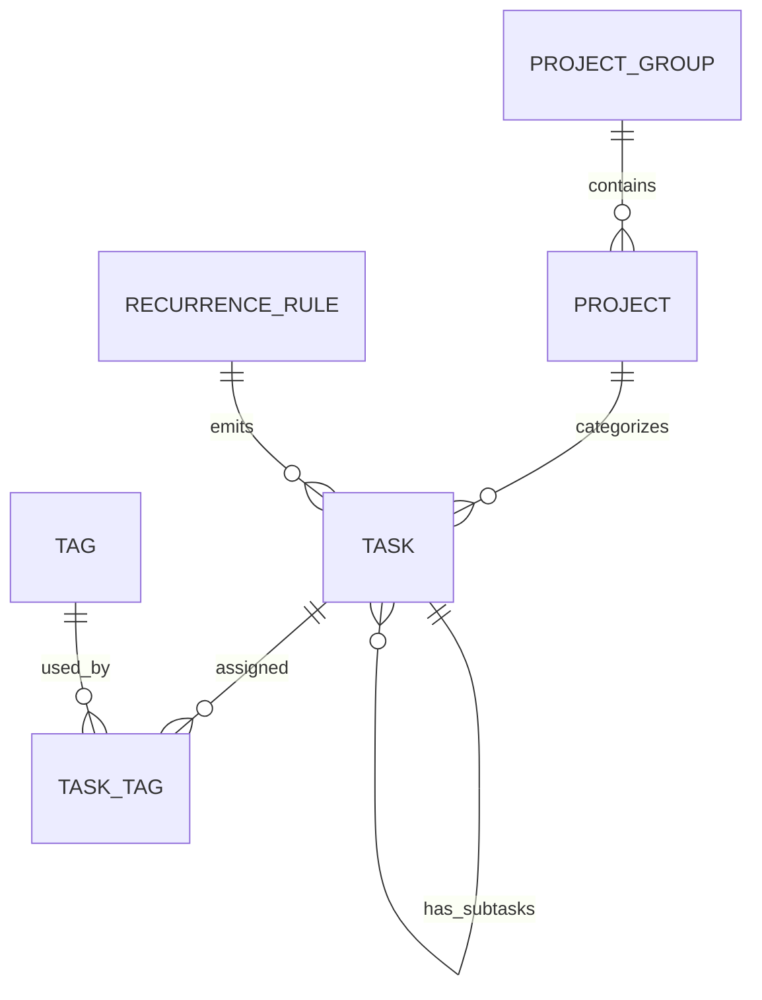

# Conceptual data model (Phase 1)

This is **a domain contract, not yet a finalized Dexie schema**. The first milestone implements only the necessary fields. All UUIDs created locally; no cloud-provider-specific identifiers.

| Entity | Candidate fields | Important rules |
|---|---|---|
| `task` | `id`, `title`, `description?`, `project_id?`, `parent_task_id?`, `due_date?`, `planned_date?`, `is_completed`, `priority`, `manual_order`, `created_at`, `updated_at`, `deleted_at?`, `recurrence_rule_id?`, `occurrence_date?`, `owner_id?` | Exactly zero/one parent; max one level; date-only due/planned; no required due date; owner reserved for future |
| `project_group` | `id`, `name`, `sort_order` | User-defined; grouping optional |
| `project` | `id`, `group_id?`, `name`, `sort_order` | A task may be unprojected; group optional |
| `tag` | `id`, `name`, `color?` | Global across groups/projects; may be on multiple tasks |
| `task_tag` | `task_id`, `tag_id` | Composite pair unique; deletion of tag removes relation, not task |
| `recurrence_rule` | `id`, `frequency`, `weekdays?`, `day_of_month?`, `rollover_enabled` | Phase 1 basic recurrence only; default rollover false |

`?` means optional. Exact Dexie indexes, field serialization, and migrations will be fixed in implementation specifications as needed. `owner_id` is not access control in Phase 1.

## Derived values (do not persist)

- **Display status:** completed => green Completed; incomplete and past due => red Overdue; due today => amber Due today; else no badge. The card itself stays theme-colored.
- **Effective board day:** for incomplete nonrecurring task with `planned_date < today`, show today without mutating original date; otherwise use planned date. For recurring occurrences, only roll if `rollover_enabled`.
- **Upcoming:** incomplete with due date within today…today+7 (boundary precision finalized in spec) or overdue unscheduled; split by scheduled (`planned_date` exists, including rolled) and unscheduled (`planned_date` absent).
- **Unscheduled:** incomplete tasks without planned dates; initial compact ranking, then full inbox.
- **Later:** incomplete tasks whose effective scheduled date falls after today+6; order by planned date. Distant due date without planned date remains Unscheduled.
- **Project progress:** completed top-level tasks / all top-level tasks for a project; parents with subtasks count once, completed only if explicitly marked.
- **Manual order:** explicit drag reordering persists; optional sort views do not overwrite it.

## Recurrence and deletion invariants

- A recurring rule produces distinct occurrence task records with a stable unique `(recurrence_rule_id, occurrence_date)` identity; generation should be idempotent.
- A missed nonrollover occurrence remains incomplete in history but does not appear in later day columns; rollover ON permits multiple occurrences on a later day.
- `deleted_at` records a soft delete. Undo notification is 10 seconds; a minimal Settings recovery action restores within 14 days. Past 14 days = eligible for cleanup on app activity, not guaranteed at a wall-clock instant.
- Deleting parent task and linked subtasks requires an explicit cascade/restore behavior in its feature spec; do not assume deleting one item leaves orphaned children.

## Open modeling details before each relevant feature

- Recurrence source/template representation, occurrence generation horizon and edits-to-series semantics.
- Parent/subtask scheduling rules when both are planned, project inheritance, and optional display of both without duplicate cards.
- `manual_order` key strategy across display-based rollover / sort mode.
- Export/import format, local database migration tests, and deletion cleanup cascade.
- Phase 2 sync: conflict clocks/versioning, tombstones, account migration and security.

## Appearance preferences (proposed; no cloud requirement)

Locally persist `palette_id`, `font_id`, and optional `preset_id` as separate settings so presets can select a coordinated palette/font without preventing individual overrides. Later user-defined palettes/presets need stable identifiers, color tokens, contrast checks, and a migration path; defer editor schema until its milestone. Appearance never changes task state or theme-independent semantic status (overdue, due today, complete).
